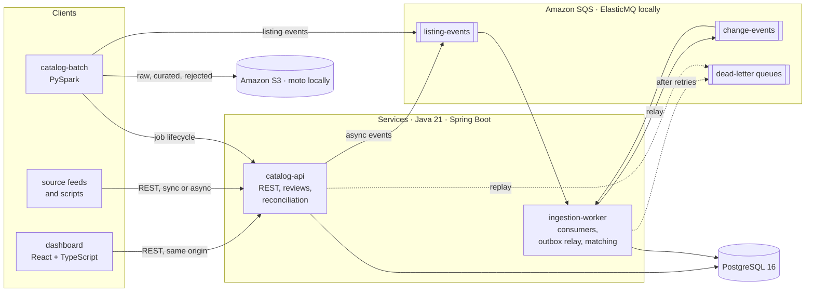

# CatalogSentinel

**Product selection and catalog monitoring for a simulated marketplace.** CatalogSentinel ingests listings from
many suppliers, works out which listings describe the same product, and tells a marketplace which products its
reference catalogs carry that it does not, how sure it is, and how urgent each gap is.

> **Independent, simulated system.** This is a portfolio project. It is not an Amazon product and is not
> affiliated with or endorsed by Amazon or any retailer. It has no access to real sales, demand or inventory
> data: every catalog it processes is hand-labeled test data or output of the included synthetic data generator,
> and the "demand" used for prioritisation is a labeled synthetic signal.


*The dashboard's coverage view, rendered from the contract-shaped test fixtures used by the dashboard's tests
(`apps/dashboard/test/fixtures/api.json`), not from a live deployment. All figures are synthetic.*

## What it does

1. **Ingests listing events** from marketplaces and reference catalogs through a synchronous API, an
   asynchronous SQS path and a restartable PySpark batch job, with identical rules on every path: replays are
   idempotent, older versions never overwrite newer data, withdrawals leave tombstones.
2. **Resolves listings to canonical products** with an explainable rule-based matcher: indexed candidate
   retrieval (GTIN, brand + model, title trigrams), five scored features, explicit rules for conflicting
   identifiers and variants, and every score and piece of evidence stored for reviewers.
3. **Detects selection gaps** for a marketplace against its reference catalogs, with a reason, a confidence, a
   priority, reviewable evidence, a lifecycle (open, confirmed, dismissed, resolved) and an append-only audit trail.
4. **Lets operators investigate and act** through a REST API and a React dashboard: coverage by category, catalog
   explorer, gap triage, side-by-side match review, batch job progress, and system health with dead-letter
   replay.

## Engineering highlights

- **Correct under at-least-once delivery**: an idempotency ledger whose primary key settles concurrent duplicate
  deliveries, request fingerprints that reject reused event ids, source-version ordering, row locks, and a
  transactional outbox with a `SKIP LOCKED` relay ([ADR 0002](docs/adr/0002-at-least-once-idempotent-processing.md),
  [ADR 0003](docs/adr/0003-transactional-outbox.md)).
- **Operable failure handling**: bounded retries with full-jitter backoff through message visibility, dead-letter
  queues with failure reasons and a replay endpoint, consumer pause on database outages, graceful drain, backlog
  gauges, alerts with a [runbook](docs/runbook.md) section each.
- **Measured matching**: every matcher version evaluated on a hand-labeled development set, a holdout set and
  synthetic sets, with quality floors enforced by a test ([results](docs/benchmarks/matching/README.md)).
- **Restartable batch**: manifest checksums, Java-parity validation and normalization in Spark (one shared golden
  fixture checked by both test suites), deterministic event ids and per-partition publish markers, so a crashed
  import resumes without losing or duplicating effects.
- **Production scaffolding**: Docker images, a one-command compose stack with SQS and S3 emulators, Terraform for
  ECS Fargate, RDS, SQS, S3 and CloudWatch with least-privilege roles (checkov clean, every skip justified), CI,
  and an approval-gated OIDC deploy workflow. **No AWS resources were created by this project.**

## Architecture



More in [docs/architecture.md](docs/architecture.md): data flows, the event-processing sequence, matching and gap
detection, the consistency mechanisms and where each is tested.

## Quick start

Requirements: Docker with Compose v2.20+, about 4 GiB of memory for the containers. No AWS account.

```bash
docker compose up -d --build --wait       # PostgreSQL, ElasticMQ, moto, API :8080, worker :8081, dashboard :3000
./scripts/seed-demo.sh 10k                # synthetic catalog → S3 emulator → Spark batch job → queue → worker → gaps
open http://localhost:3000                # dashboard
./scripts/smoke.sh                        # end-to-end checks: HTTP, queues, worker, batch container
./scripts/inject-failure.sh worker-crash  # failure drills: db-outage | worker-crash | poison-message | batch-crash
```

API documentation: `http://localhost:8080/swagger-ui.html`, and [docs/api.md](docs/api.md) with examples.
Deployment to AWS (manual, billable, never automatic): [docs/deployment.md](docs/deployment.md).

## Measured results

All measured on a 2-vCPU cloud sandbox with PostgreSQL on the same machine; methods, machine details and caveats
in [docs/benchmarking.md](docs/benchmarking.md). Development-machine figures, not production capacity claims.

| What | Result |
|---|---|
| Matching quality, `rules-v4` (golden development set, 150 listings) | auto-match precision 1.000, recall 0.456; with the review queue F1 0.829 (title-only baseline 0.352) |
| Matching on unseen synthetic samples (seed 2027, 570 listings) | auto-match precision 0.982 (0.920 for `rules-v3`) at unchanged recall 0.875 |
| Candidate retrieval (blocking) | 100 % of true pairs kept, 93–98 % of all pairs pruned, on every labeled set |
| Ingestion engine (ledger + versioned upsert + outbox, one transaction per event) | 1 thread: median 460 events/s (308–509, 3 runs), p50 1.8–3.1 ms. 8 threads: median 828 events/s (536–898, 9 runs), median p99 29.5 ms; both vCPUs saturated |
| Duplicate delivery | 2,000 replayed events → 2,000 recognised, no writes; 10 rounds × 8 simultaneous deliveries → exactly one effect each |
| Gap detection (golden catalog) | every true gap surfaced (19/19); confident gaps precision 0.778, recall 0.737 |
| Batch job, Spark dry run (`local[2]`) | 431,719-record export validated, normalized and written in 83.9 s |
| Title-trigram retrieval | GIN index 17–28 ms against 208–220 ms sequential scan; 84 % of database statement time in a profiled matching run (the bottleneck) |

The labeled sets are small and partly synthetic, so accuracy on real catalogs is unknown; see each result's
stated bias.

## Verification status

The project was built in an environment where Maven Central and Docker Hub were unreachable. What that means:

| Part | Status |
|---|---|
| Domain rules, application services and all SQL (242 tests; integration tests run against PostgreSQL 16) | **Executed, passing** with a substitute harness (`javac` + JUnit, real PostgreSQL); not a Maven build |
| PySpark batch job (891 tests, 853 of them normalizer parity cases) | **Executed, passing** with Spark 4.2.1 and moto |
| Smoke, seed, drill and benchmark tooling (33 tests) | **Executed, passing**; the scripts' expected outcomes are also pinned by `SmokeScenarioIT` |
| Dashboard (17 tests) and production build | **Executed, passing** |
| Spring Boot applications and their integration tests (`CatalogApiIT`, `SecuredApiIT`, `WorkerPipelineIT`) | **Type-checked only**, against API stubs; never compiled against the real Spring Boot 4.1 libraries |
| Compose file, workflows, scripts | **Static checks pass** (`docker compose config`, actionlint, shellcheck) |
| `mvn verify`, Docker images, compose stack, smoke test, seed, failure drills, `terraform validate` | **Not executed** here (Maven Central, Docker Hub and the Terraform registry are blocked); CI runs the first four |

Run `mvn -B verify` on a networked machine first. Details: [docs/testing.md](docs/testing.md),
[docs/IMPLEMENTATION_STATUS.md](docs/IMPLEMENTATION_STATUS.md), which includes the feature verification matrix, and
[docs/REPAIR_VERIFICATION_LOG.md](docs/REPAIR_VERIFICATION_LOG.md), every verification step of the last repair pass
with its evidence.

## Repository layout

```text
apps/
  catalog-api/          REST API, security, reconciliation runner, operator endpoints
  ingestion-worker/     SQS consumers, outbox relay, backlog monitoring
  dashboard/            React + TypeScript operations console (nginx image)
libs/
  catalog-domain/       pure rules: event decisions, normalization, matching, gap assessment, evaluation
  event-contracts/      versioned JSON contracts
  catalog-core/         transactional services and SQL (Spring JDBC)
  platform-adapters/    AWS SDK v2 SQS client, Jackson, Micrometer, correlation ids
jobs/catalog-batch/     PySpark batch import
db/migrations/          Flyway migrations V1–V4;  db/seeds/ demo sources
infra/compose/          local stack (ElasticMQ, moto, Prometheus, Jaeger)
infra/terraform/        AWS: network, messaging, storage, database, service, observability
scripts/                smoke test, demo seeding, failure drills, benchmarks, synthetic data generator
tests/                  golden matching sets, parity fixture, end-to-end map
docs/                   architecture, database, API, security, runbook, deployment, testing, benchmarks, ADRs
```

## Documentation

| Document | Contents |
|---|---|
| [Architecture](docs/architecture.md) | Components, data flows, delivery semantics, matching, gaps, observability |
| [Database](docs/database.md) | ER diagram, constraints and indexes with their reasons, transactions, migrations |
| [API](docs/api.md) | Conventions, every endpoint with roles and status codes, examples |
| [Security](docs/security.md) | Authentication, authorization matrix, secrets, IAM, accepted risks |
| [Runbook](docs/runbook.md) | Alerts, diagnosis, replay and recovery procedures, failure drills |
| [Deployment](docs/deployment.md) | Local stack; AWS bootstrap, deploy workflow, cost, tear-down |
| [Testing](docs/testing.md) | Test suites and what was executed |
| [Benchmarking](docs/benchmarking.md) | Every measurement with method and caveats |
| [Decisions](docs/adr/README.md) | Architecture decision records |
| [Demo script](docs/demo-script.md) | A 3–5 minute walkthrough |
| [Interview guide](docs/interview-guide.md) | Design questions and answers grounded in this code |
| [Resume bullets](docs/resume-bullets.md) | Four bullets backed by the measurements above |

## Technology

Java 21, Spring Boot 4.1, Spring JDBC, Flyway, PostgreSQL 16 with `pg_trgm`, AWS SDK for Java v2 (SQS),
Micrometer and OpenTelemetry; PySpark 4.2 and boto3; React 19, TypeScript, TanStack Query, Vite; Docker Compose,
ElasticMQ, moto; Terraform (ECS Fargate, RDS, SQS, S3, CloudWatch, X-Ray); GitHub Actions; JUnit 5,
Testcontainers, pytest, Vitest, MSW.

## Known limitations

- The Spring Boot applications have not yet been compiled against the real libraries (see above).
- Matching is rule-based and tuned on small labeled sets; recall is deliberately traded for precision.
- Reconciliation jobs are durable (database poller with leases and retries) but run in the API process by
  default and share its connection pool; large catalogs would run the poller in a dedicated task.
- API keys identify clients, not people; a real deployment would add SSO in front of the dashboard.
