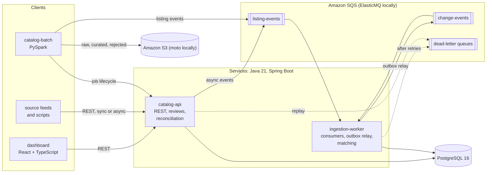
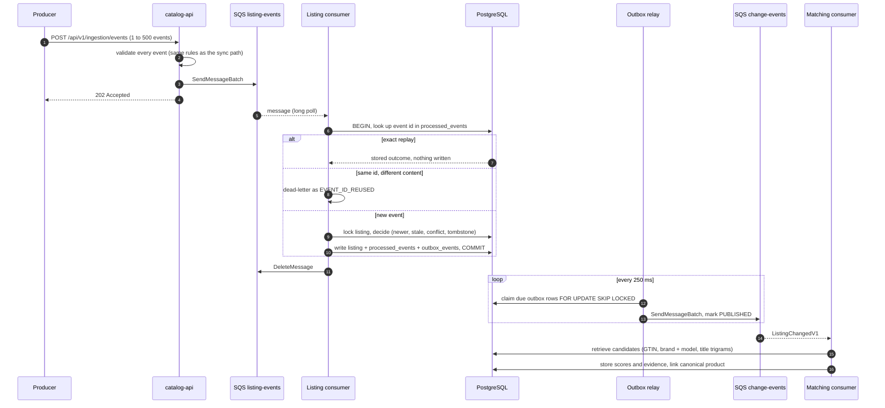
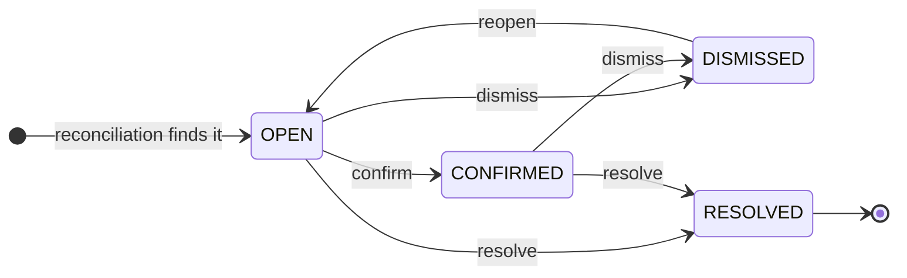
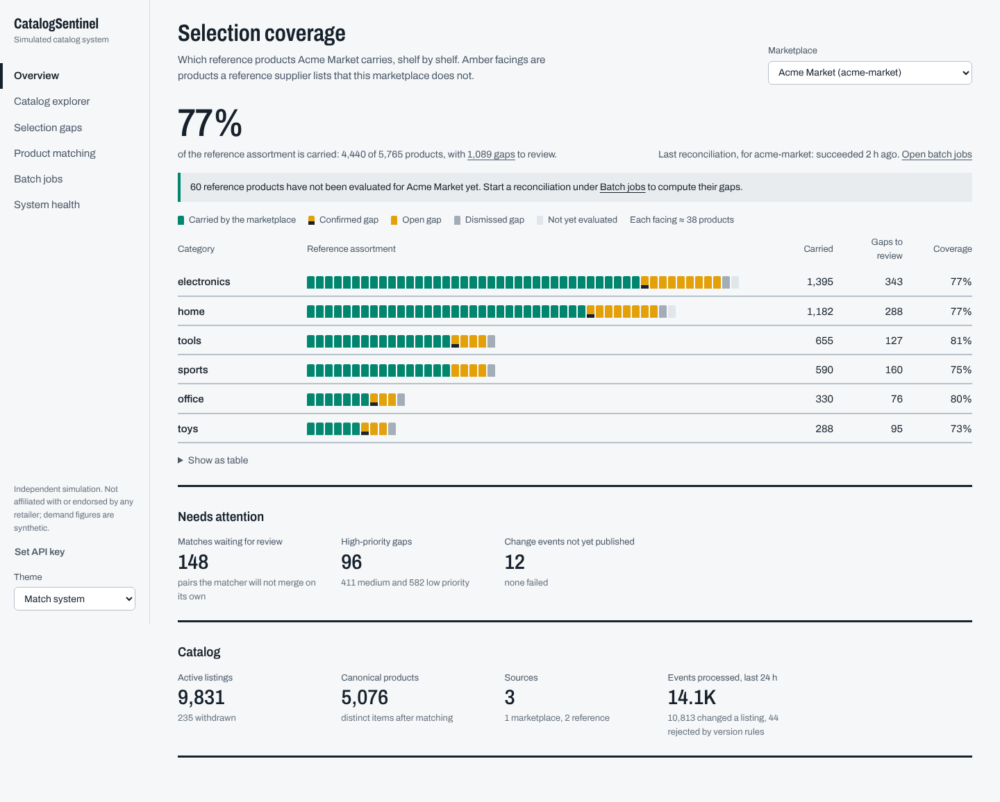
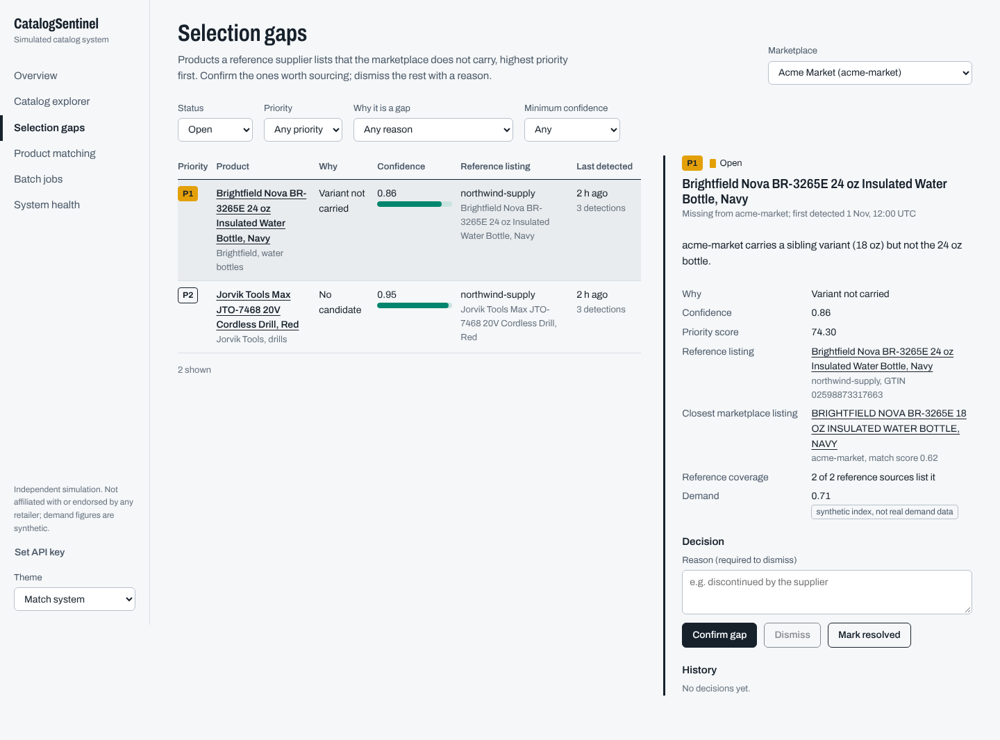
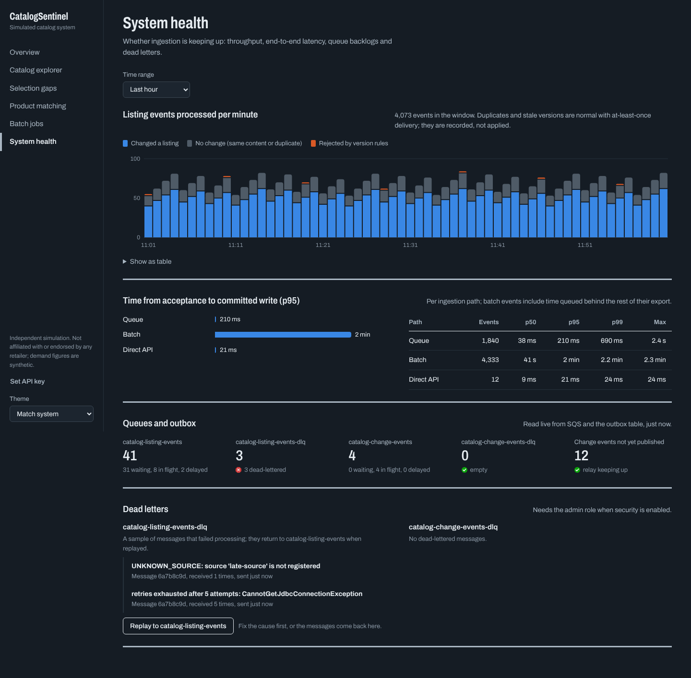

<div align="center">

<picture>
  <source media="(prefers-color-scheme: dark)" srcset="docs/assets/readme/hero-dark.svg">
  
</picture>

[](https://github.com/narendarreddyk7-beep/catalogsentinel/actions/workflows/ci.yml)


</div>

> [!NOTE]
> **A portfolio project running on simulated data.** CatalogSentinel is not an Amazon product and is not
> affiliated with or endorsed by Amazon or any retailer. Every catalog it processes is hand-labeled test data or
> output of the included synthetic data generator, and the demand signal used for prioritization is labeled
> synthetic. It has no access to real sales, demand or inventory data.

## The idea in one picture

A marketplace wants to know which products its reference catalogs carry that it doesn't. That's harder than it
sounds, because the same product arrives from every supplier with a different title, a missing brand or a
regional model number, while two genuinely different products (black and silver of the same headphones) can look
almost identical.

<picture>
  <source media="(prefers-color-scheme: dark)" srcset="docs/assets/readme/story-dark.svg">
  
</picture>

CatalogSentinel does this in three steps:

1. **Ingest** listing events from reference catalogs and marketplaces, through a REST API, an SQS queue or a
   restartable PySpark batch job. All three apply the same rules.
2. **Match** listings to canonical products with an explainable rule-based matcher, storing every score and piece
   of evidence for reviewers.
3. **Report gaps:** for each marketplace, the reference products it doesn't carry, each with a reason, a
   confidence, a priority and a review workflow.

The picture is a real example. The listings come from the hand-labeled golden set, and every score, reason and
priority in it was produced by the actual matcher and gap assessor.

## How a listing travels



Every event is written in one database transaction together with its idempotency record and an outbox row. A
relay publishes the outbox to the change queue, and matching consumes it. If the worker dies anywhere in between,
redelivery finishes the job without doing anything twice.

<details>
<summary><b>Step by step: one event under at-least-once delivery</b></summary>



Transient failures back off with full jitter through message visibility (2 s up to 5 min). After 5 receives a
message goes to the dead-letter queue with a failure reason, and malformed or invalid messages go there at once.
More in [docs/architecture.md](docs/architecture.md).

</details>

## Matching you can audit

Title similarity alone picks the wrong product here. The marketplace's reworded listing of the black headphones
has a *less* similar title (0.62) than the silver variant does (0.78). The matcher still gets both right, and it
stores the reasons with each pair:

<picture>
  <source media="(prefers-color-scheme: dark)" srcset="docs/assets/readme/match-cards-dark.svg">
  
</picture>

The weighted score only counts features present on both sides, so a missing brand is not a mismatch. Explicit
rules then decide, in this order (simplified from
[`RuleBasedMatcher`](libs/catalog-domain/src/main/java/io/catalogsentinel/domain/matching/RuleBasedMatcher.java)):

```mermaid
flowchart TD
    pair(["candidate pair"]) --> gtin{"Same GTIN?"}
    gtin -- "yes" --> gtinconf{"Brand, model, tier<br/>or variant conflict?"}
    gtinconf -- "no" --> A1(["AUTO_MATCH"])
    gtinconf -- "yes: likely bad data" --> R1(["REVIEW"])
    gtin -- "no, or not on both" --> hard{"Brand, model, tier<br/>or variant conflict?"}
    hard -- "yes" --> N1(["NO_MATCH"])
    hard -- "no" --> diff{"Different GTINs?"}
    diff -- "yes, model agrees,<br/>score ≥ 0.70" --> R2(["REVIEW"])
    diff -- "yes, otherwise" --> N2(["NO_MATCH"])
    diff -- "no" --> ids{"Model and brand agree?"}
    ids -- "yes, variants stated<br/>on both sides" --> A2(["AUTO_MATCH"])
    ids -- "yes, a variant unstated" --> R3(["REVIEW"])
    ids -- "no" --> score{"Weighted score"}
    score -- "≥ 0.90 with<br/>model agreement" --> A3(["AUTO_MATCH"])
    score -- "≥ 0.70" --> R4(["REVIEW"])
    score -- "< 0.70" --> N3(["NO_MATCH"])

    classDef auto stroke:#0D9488,stroke-width:2.5px
    classDef review stroke:#6366F1,stroke-width:2px,stroke-dasharray:5 3
    classDef none stroke:#C2410C,stroke-width:2.5px
    class A1,A2,A3 auto
    class R1,R2,R3,R4 review
    class N1,N2,N3 none
```



Auto-matching always needs identifier agreement (GTIN or model number). Title similarity alone can reach
review, never a merge. Candidates come from indexed retrieval (GTIN, brand + model, PostgreSQL title trigrams),
which keeps every true pair on all labeled sets while pruning 93 to 98% of the rest. When a listing's content
changes, its old evidence stops counting ([ADR 0013](docs/adr/0013-match-evidence-currency.md)).

## From "missing" to "what to do about it"

A gap is more than "not found". Each one records **why** the product looks missing, which sets how sure the
system is:

| Reason | What it means | Confidence |
|---|---|---|
| `NO_CANDIDATE` | Retrieval found nothing similar in the marketplace | 0.95 |
| `CANDIDATE_REJECTED` | A reviewer rejected the closest listing as a different product | 0.92 |
| `VARIANT_NOT_CARRIED` | The marketplace carries a sibling variant, not this one | 0.90 |
| `ONLY_NON_MATCHING_CANDIDATES` | Similar listings exist, but all scored below review | 0.95 − 0.5 × score (0.50 to 0.95) |
| `UNCONFIRMED_CANDIDATE` | A plausible match awaits human review, so the gap may close | 0.45 − (score − 0.70) (0.25 to 0.45) |

**Priority** combines that confidence with a synthetic demand index and how many reference sources carry the
product:

```text
priority = 100 × (0.5 × confidence + 0.3 × demand + 0.2 × reference coverage)      P1 ≥ 70, P2 ≥ 50, else P3

silver headphones:  100 × (0.5 × 0.90 + 0.3 × 0.50 + 0.2 × 1.0) = 80  →  P1
                                       └ no demand signal, so the neutral 0.50 is used
```

Operators then work the queue. Every decision is checked against this state machine and written to an
append-only audit trail:



When two canonical products turn out to be one, their gaps follow the merge and keep their human decisions
([ADR 0014](docs/adr/0014-gaps-follow-product-merges.md)).

## Built for at-least-once delivery

Queues deliver twice, workers crash, and events arrive out of order. Each guarantee below has a mechanism and a
test that tries to break it. All of these tests run in CI against a real PostgreSQL.

| What can go wrong | What prevents damage | Proven by |
|---|---|---|
| The same event delivered twice, or 8 times at once | Idempotency ledger whose primary key settles the race | `ConcurrentIngestionIT`, `AsyncPipelineIT` |
| An event id reused for different content | Request fingerprints; rejected as `EVENT_ID_REUSED` | `ListingIngestionServiceIT` |
| Versions arriving out of order | Source-version ordering under a row lock; withdrawals leave tombstones | `ListingIngestionServiceIT`, `ConcurrentIngestionIT` |
| Worker crash between the database commit and publishing | Transactional outbox; relay claims rows with `SKIP LOCKED` | `AsyncPipelineIT` |
| Database outage | Retries through message visibility; consumers pause and probe | `AsyncPipelineIT`, `QueueConsumerTest` |
| A poison message | Dead-letter queue with a failure reason, plus a replay endpoint | `QueueConsumerTest`, `AsyncPipelineIT` |
| A reconciliation runner dies mid-job | Durable jobs with leases, fencing and bounded retries | `ReconciliationJobDurabilityIT` |
| A listing changes after it was matched | Evidence pinned to content hashes; stale evidence is superseded | `StaleMatchEvidenceIT` |
| A batch import crashes halfway | Manifest checksums, deterministic event ids, per-partition publish markers | `IngestionJobServiceIT`, batch `pytest` suite |

Decisions are recorded as [ADRs](docs/adr/README.md). Operational procedures for every alert are in the
[runbook](docs/runbook.md).

## Results

<picture>
  <source media="(prefers-color-scheme: dark)" srcset="docs/assets/readme/matching-quality-dark.svg">
  
</picture>

| Measurement | Result |
|---|---|
| Auto-match precision, `rules-v4` | 1.000 on both golden sets (recall 0.456 dev, 0.440 holdout); 0.982 on unseen synthetic samples, seed 2027 (recall 0.875) |
| Candidate retrieval | 100% of true pairs kept, 93 to 98% of all pairs pruned, on every labeled set |
| Gap detection, golden catalog | All 19 true gaps surfaced; confident gaps: precision 0.778, recall 0.737 |
| Ingestion (ledger + versioned upsert + outbox, one transaction per event) | 8 threads: median 828 events/s over 9 runs (range 536 to 898), median p99 29.5 ms |
| Duplicate delivery | 2,000 replayed events recognised with no writes; 10 rounds × 8 simultaneous deliveries, one effect each |
| Event to canonical link, in process | p50 17.9 ms, p99 30.0 ms |
| Spark batch import (`local[2]`) | 431,719 records validated, normalized and written in 83.9 s |
| Title-trigram retrieval | GIN index 17 to 28 ms vs 208 to 220 ms with a sequential scan |

Measured on a 2-vCPU cloud sandbox with PostgreSQL on the same machine. These are development-machine figures, not
production capacity claims. The labeled sets are small and partly synthetic, so accuracy on real catalogs is
unknown. Methods and caveats for every number: [docs/benchmarking.md](docs/benchmarking.md) and
[docs/benchmarks/matching](docs/benchmarks/matching/README.md).

## The dashboard



<table>
  <tr>
    <td width="50%"></td>
    <td width="50%"></td>
  </tr>
  <tr>
    <td>Gap triage: evidence, priority and decisions</td>
    <td>System health: queue depths, dead letters, batch jobs</td>
  </tr>
</table>

<sub>Rendered from the contract-shaped fixtures used by the dashboard's tests (`apps/dashboard/test/fixtures/api.json`),
not from a live deployment. All figures are synthetic.</sub>

## Run it locally

You need Docker with Compose v2.20+ and about 4 GiB of memory for the containers. No AWS account is required:
SQS and S3 are emulated.

```bash
docker compose up -d --build --wait       # PostgreSQL, ElasticMQ, moto, API :8080, worker :8081, dashboard :3000
./scripts/seed-demo.sh 10k                # synthetic catalog → S3 emulator → Spark batch job → queue → worker → gaps
open http://localhost:3000                # the dashboard
./scripts/smoke.sh                        # end-to-end checks: HTTP, queues, worker, batch container
./scripts/inject-failure.sh worker-crash  # failure drills: db-outage | worker-crash | poison-message | batch-crash
```

API reference: `http://localhost:8080/swagger-ui.html` and [docs/api.md](docs/api.md). Deploying to AWS is
manual, billable and never automatic: see [docs/deployment.md](docs/deployment.md).

## What CI checks on every push

| Job | What runs |
|---|---|
| Java build, unit and integration tests | `mvn -B -ntp verify` on Java 21. Every module compiles against the real Spring Boot 4.1 libraries; unit tests run, and integration tests run against PostgreSQL 16 and ElasticMQ in Testcontainers |
| PySpark batch job | The batch job's `pytest` suite, including normalization parity with the Java code, plus the smoke, seed and drill tooling's own tests |
| Dashboard | Vitest suite and production build |
| Terraform and compose checks | `terraform fmt` and `validate`, checkov, `docker compose config` |
| Container images build | Builds all four images, starts the compose stack, and runs `scripts/smoke.sh` end to end against it; exports the OpenAPI spec |

All five passed on [run #5](https://github.com/narendarreddyk7-beep/catalogsentinel/actions/workflows/ci.yml)
(commit `478f0f2`), the first full CI run; the badge above shows the current status. Not run in CI: the
large-scale seed, the failure drills end to end, and the benchmarks. No AWS resources have been created; the
deploy workflow is manual and approval-gated. Verification notes written before CI existed
([IMPLEMENTATION_STATUS](docs/IMPLEMENTATION_STATUS.md), [REPAIR_VERIFICATION_LOG](docs/REPAIR_VERIFICATION_LOG.md))
describe the earlier sandbox harness.

## Repository map

```text
apps/
  catalog-api/          REST API, security, reconciliation runner, operator endpoints
  ingestion-worker/     SQS consumers, outbox relay, backlog monitoring
  dashboard/            React + TypeScript operations console (nginx image)
libs/
  catalog-domain/       pure rules: event decisions, normalization, matching, gap assessment, evaluation
  event-contracts/      versioned JSON contracts
  catalog-core/         transactional services and SQL (Spring JDBC)
  platform-adapters/    AWS SDK v2 SQS client, Jackson, Micrometer, correlation ids
jobs/catalog-batch/     PySpark batch import
db/migrations/          Flyway migrations V1 to V6
infra/compose/          local stack (ElasticMQ, moto, Prometheus, Jaeger)
infra/terraform/        AWS: network, messaging, storage, database, service, observability
scripts/                smoke test, demo seeding, failure drills, benchmarks, synthetic data generator
tests/                  golden matching sets, parity fixture, end-to-end map
docs/                   architecture, database, API, security, runbook, deployment, testing, benchmarks, ADRs
```

## Documentation

| Document | Contents |
|---|---|
| [Architecture](docs/architecture.md) | Components, data flows, delivery semantics, matching, gaps, observability |
| [Database](docs/database.md) | ER diagram, constraints and indexes with their reasons, transactions, migrations |
| [API](docs/api.md) | Conventions, every endpoint with roles and status codes, examples |
| [Security](docs/security.md) | Authentication, authorization matrix, secrets, IAM, accepted risks |
| [Runbook](docs/runbook.md) | Alerts, diagnosis, replay and recovery procedures, failure drills |
| [Deployment](docs/deployment.md) | Local stack; AWS bootstrap, deploy workflow, cost, tear-down |
| [Testing](docs/testing.md) | Test suites and what each covers |
| [Benchmarking](docs/benchmarking.md) | Every measurement with its method and caveats |
| [Decisions](docs/adr/README.md) | Architecture decision records |
| [Demo script](docs/demo-script.md) | A 3 to 5 minute walkthrough |
| [Interview guide](docs/interview-guide.md) | Design questions and answers grounded in this code |
| [Resume bullets](docs/resume-bullets.md) | Bullets backed by the measurements above |

The README illustrations are generated by
[`docs/assets/readme/make_readme_svgs.py`](docs/assets/readme/make_readme_svgs.py) from the matcher's output and
the recorded benchmarks; re-run it if those change.

## Technology

**Services:** Java 21, Spring Boot 4.1, Spring JDBC, Flyway, PostgreSQL 16 with `pg_trgm`, AWS SDK for Java v2
(SQS), Micrometer, OpenTelemetry.
**Batch:** PySpark 4.2, boto3.
**Dashboard:** React 19, TypeScript, TanStack Query, Vite.
**Infrastructure:** Docker Compose, ElasticMQ, moto, Terraform (ECS Fargate, RDS, SQS, S3, CloudWatch, X-Ray),
GitHub Actions.
**Tests:** JUnit 5, Testcontainers, pytest, Vitest, MSW.

## Known limitations

- Matching is rule-based and tuned on small labeled sets; recall is deliberately traded for precision.
- Reconciliation jobs are durable but run in the API process by default and share its connection pool. Large
  catalogs would run the poller in a dedicated task.
- API keys identify clients, not people. A real deployment would put SSO in front of the dashboard.
- The failure drills and the 100k-listing seed have not been run end to end; the recovery behaviors they exercise
  are covered by the integration tests above.
