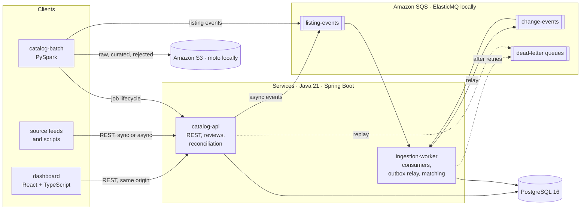
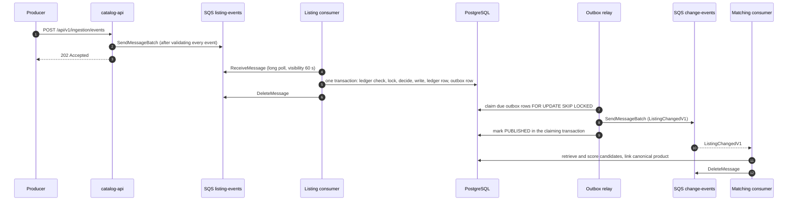
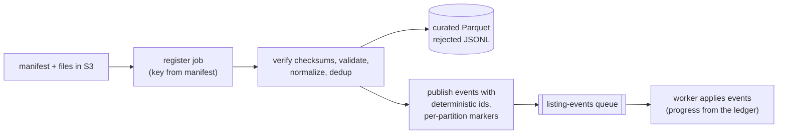

# Architecture

CatalogSentinel is an independent, simulated system built for a software engineering portfolio. It is not an
Amazon product, is not endorsed by Amazon, and has no access to any real marketplace's sales, demand or
inventory data. Every catalog it processes is either hand-labeled test data or produced by
`scripts/generate-synthetic-data.py`.

It answers one operational question for a marketplace: *which products that reference catalogs carry are
missing from our selection, how sure are we, and how urgent is it?* To answer it, the platform ingests listings
from many sources, resolves them to canonical products, compares the marketplace against reference catalogs,
and gives operators an API and a dashboard to investigate and review.

## Quality goals

| Goal | What it means here | Main mechanisms |
|---|---|---|
| Correct under at-least-once delivery | A redelivered, duplicated, reordered or concurrent event never produces a second effect or overwrites newer data | Idempotency ledger, source-version ordering, row locks, unique constraints, transactional outbox |
| Explainable decisions | Every match and every gap carries the evidence and the rule that produced it | Rule-based matcher with stored feature scores and evidence; gap reasons with explanations |
| Operable | Failures are visible, bounded and recoverable without code changes | Bounded retries, DLQs with reasons, replay endpoints, backlog gauges, readiness, alerts, runbook |
| Reproducible locally | The full system runs with one compose command and no AWS account | ElasticMQ for SQS, moto for S3, synthetic data generator |
| Measured, not asserted | Accuracy and performance numbers come from runs recorded in the repository | Evaluation CLI, labeled sets, benchmark harnesses ([benchmarking.md](benchmarking.md)) |

Non-goals: real marketplace data, machine-learned matching, exactly-once delivery (SQS does not offer it for
standard queues and the design does not need it), multi-region operation.

## System overview

Rendered copies of every diagram live in [diagrams/](diagrams/) (`.mmd` sources and `.svg` renders).

## Components

| Component | Responsibility | Technology |
|---|---|---|
| `libs/catalog-domain` | Pure domain logic: listing event decisions (versions, tombstones), normalization (`norm-v2`), blocking, the explainable matcher (`rules-v4`), gap assessment (`gap-v1`), the evaluation CLI. No framework, no I/O. | Java 21 |
| `libs/event-contracts` | Versioned JSON contracts on the wire: `ListingEventV1`, `ListingChangedV1`, metadata, message attribute names | Java records, Jackson annotations |
| `libs/catalog-core` | Transactional application services and SQL: ingestion, matching and canonical linking, reconciliation, review with audit, outbox relay, queue consumer, DLQ replay, batch job lifecycle, dashboard queries | Spring JDBC and transactions, PostgreSQL |
| `libs/platform-adapters` | Implementations of the core's ports: SQS client (AWS SDK v2), JSON codec, Micrometer metrics, correlation-id filter | AWS SDK v2, Jackson, Micrometer |
| `apps/catalog-api` | REST API with OpenAPI, validation and problem-detail errors; API-key security; reconciliation runner; operator endpoints (DLQ, outbox) | Spring Boot 4.1, springdoc |
| `apps/ingestion-worker` | Listing-event consumer (8 concurrent), change-event consumer that runs matching (4 concurrent), outbox relay, queue backlog gauges and readiness | Spring Boot 4.1 |
| `apps/dashboard` | Six investigation and monitoring views over the real API | React 19, TypeScript, TanStack Query, Vite; nginx in the container |
| `jobs/catalog-batch` | Bulk import: manifest verification, validation and normalization with Java parity, curated Parquet, rejected records, restartable event publishing | PySpark 4.2, boto3 |
| `infra/compose`, `infra/terraform` | Local stack; AWS infrastructure (not applied by this project) | Docker Compose; Terraform with ECS Fargate, RDS, SQS, S3, CloudWatch |

**Dependency rule.** `catalog-domain` depends on nothing; `catalog-core` depends on the domain and the contracts
and defines ports (`QueueClient`, `JsonCodec`, `ConsumerMetrics`, `IngestionMetrics`) that
`platform-adapters` implements; the two applications only wire beans and expose transports. This is why most
of the system's behaviour is testable without Spring Boot, SQS or HTTP (see [testing.md](testing.md)).
[ADR 0001](adr/0001-modular-monorepo.md) records the choice of one repository with shared libraries over
separate services per capability.

## Data flows

### 1. Listing ingestion (synchronous, asynchronous, batch)

All three paths end in the same `ListingIngestionService.ingest` call, so the rules are identical:

- **Synchronous** `POST /api/v1/listing-events`: the API applies the event in its own transaction and returns the
  outcome (201 for a new listing, 200 for updates, replays and stale events, 409 for conflicts).
- **Asynchronous** `POST /api/v1/ingestion/events`: the API validates every event of the batch (1–500) with the same
  rules, sends them to the `catalog-listing-events` queue and answers 202. The worker applies them.
- **Batch**: the Spark job publishes one event per valid record to the same queue (below).

Per event, inside one READ COMMITTED transaction:

1. Look up the event id in `processed_events`. An exact replay returns the stored outcome and writes nothing; the
   same id with a different fingerprint is rejected as `EVENT_ID_REUSED`.
2. Lock the listing row (`SELECT … FOR UPDATE`) or create it (`INSERT … ON CONFLICT DO NOTHING`), so concurrent
   events for one listing serialize and creation races are settled by the unique constraint.
3. Decide with the pure `ListingEventDecider`: a newer `sourceVersion` updates; an older one is `STALE_IGNORED`; the
   same version with different content is a `VERSION_CONFLICT`; a withdrawal leaves a tombstone that older events
   cannot resurrect; a newer upsert reactivates it.
4. Insert the ledger row. If a concurrent delivery of the same event committed first, the insert affects nothing,
   the transaction rolls back and the retry returns the stored outcome: the primary key is the final arbiter.
5. When the catalog changed, append a `ListingChangedV1` row to `outbox_events` in the same transaction.

### 2. Event processing under at-least-once delivery

The complete version with the replay, conflict and failure branches is
[diagrams/event-processing-sequence.mmd](diagrams/event-processing-sequence.mmd).

Consumer behaviour (`QueueConsumer`, one per queue):

| Concern | Behaviour |
|---|---|
| Concurrency | One poller; up to N messages in flight on virtual threads (8 for listing events, 4 for change events). It never receives more messages than it has free permits, so nothing waits in memory while invisible. |
| Visibility | Messages stay invisible for 60 s; a heartbeat extends the timeout while a slow handler is still working. |
| Retries | A transient failure (database, connection, unknown exception) re-schedules the message with `ChangeMessageVisibility`, exponential backoff with full jitter from 2 s to 5 min. |
| Dead letters | After 5 receives, or immediately for a permanent failure (malformed JSON, invalid event, unknown or disabled source, reused event id), the message is copied to the DLQ with `failureReason`, `originalMessageId` and `receiveCount` attributes, then deleted. The queues' redrive policy (`maxReceiveCount` 6) is the safety net for a worker that crashes before it can do this. |
| Dependency outages | After 5 consecutive outage-type failures the consumer stops polling for 15 s and resumes only when a database probe passes, so an outage does not burn receive counts and flood the DLQ. |
| Shutdown | Polling stops, in-flight messages get up to 25 s to finish; anything unfinished becomes visible again and is redelivered, which is safe. |
| Replay | `POST /api/v1/admin/dead-letters/replay` moves DLQ messages back to their source queue; consumers are idempotent, so replaying an already-applied message is a no-op. |

Why there is no exactly-once claim: SQS standard queues deliver at least once and may reorder. The design makes
the *effect* happen once instead ([ADR 0002](adr/0002-at-least-once-idempotent-processing.md)), and publishes
change events through a transactional outbox so a committed change is never lost and an uncommitted one is never
announced ([ADR 0003](adr/0003-transactional-outbox.md)).

### 3. Batch ingestion

The job key is `sourceCode:sha256(canonical manifest)`, so submitting the same manifest again resumes the same
job instead of creating a duplicate. Event ids are UUIDv5 values derived from the job key, source, external id,
version and event type, so a re-run after a crash publishes the same ids and the ledger absorbs the overlap.
Publishing is split into `crc32(eventId) mod N` partitions, each with a completion marker; a restarted attempt
skips finished partitions. Job progress is derived from `processed_events.ingestion_job_id` rather than counted
on the job row, which would turn it into a hot row under concurrent workers. Details:
[diagrams/batch-pipeline.mmd](diagrams/batch-pipeline.mmd), [jobs/catalog-batch/README.md](../jobs/catalog-batch/README.md),
[ADR 0008](adr/0008-batch-through-the-event-pipeline.md).

### 4. Matching and canonical products

Triggered for each `ListingChangedV1` (and in bulk before every reconciliation):

1. **Normalize** (`norm-v2`): case, accents, punctuation, units (`64 GB`, `1TB`, `20V`, `18 oz`), brand aliases,
   model identifiers, category paths; extract variant-defining attributes (capacity, size, colour, voltage, pack
   quantities).
2. **Retrieve candidates** (blocking) with three indexed queries instead of comparing against every listing:
   exact GTIN, normalized brand plus model prefix (B-tree with `text_pattern_ops`), and the top 10 by title trigram
   similarity (`pg_trgm` GIN index). On every labeled set this kept 100 % of true pairs while discarding 93–98 %
   of all pairs.
3. **Score** five features (model 0.35, title 0.25, brand 0.15, attributes 0.15, category 0.10; missing features
   drop out of the weighted average) and GTIN agreement.
4. **Apply explicit rules** that override the score in precedence order: equal valid GTINs force a match;
   conflicting GTINs, brands, models, variant attributes or tiers cap the score or force `NO_MATCH`.
5. **Decide**: score ≥ 0.90 `AUTO_MATCH`, ≥ 0.70 `REVIEW`, otherwise `NO_MATCH`. Feature scores, evidence codes and
   the matcher version are stored on `match_candidates`.
6. **Link**: a listing joins the canonical product of a human-approved candidate first, then of its best
   `AUTO_MATCH`; otherwise it keeps its own identity. `REVIEW` pairs never merge identities automatically. Two
   matching listings first seen concurrently may each create an identity; a merge pass converges them before every
   reconciliation.

Accuracy was measured on hand-labeled and synthetic sets, per version, with the bias of each set stated
([benchmarks/matching/README.md](benchmarks/matching/README.md), [ADR 0004](adr/0004-explainable-rule-based-matching.md)).

### 5. Selection-gap detection

A reconciliation run (`POST /api/v1/reconciliation/jobs` records a durable job; a database-backed poller in any
API instance claims and runs it) for one target marketplace:

1. Brings matching up to date for unlinked or changed listings and merges duplicate identities. Live gaps on
   products that were merged away move to the surviving product with their status and review history, unless the
   survivor already has a gap ([ADR 0014](adr/0014-gaps-follow-product-merges.md)).
2. For every canonical product with an **eligible** reference listing — `ACTIVE`, from an **enabled** reference
   source, and from the selected source when the run is scoped to one — (keyset batches of 200): if the target
   carries it, any open gap is resolved; otherwise `GapAssessor` classifies the closest **current** candidate and
   the gap is upserted. Coverage numerator and denominator and the demand value use the same eligibility.
3. Resolves gaps whose product was merged away, lost all its reference listings, or is listed only by disabled
   reference sources (`MERGED_PRODUCT`, `REFERENCE_WITHDRAWN`, `REFERENCE_SOURCE_DISABLED`).

Match evidence counts only while it is **current**: both listings `ACTIVE` with the content hashes they were scored
with. Changing a listing supersedes its old candidates (an audit row records any human decision that was
superseded), re-derives its product membership, and regroups the product it left so that members which are no
longer connected by current evidence split apart ([ADR 0013](adr/0013-match-evidence-currency.md)).

| Reason | Meaning | Confidence |
|---|---|---|
| `NO_CANDIDATE` | Nothing in the target resembles the product | 0.95 |
| `CANDIDATE_REJECTED` | A reviewer rejected the closest candidate | 0.92 |
| `VARIANT_NOT_CARRIED` | The closest candidate is a sibling variant (other capacity, size, tier) | 0.90 |
| `ONLY_NON_MATCHING_CANDIDATES` | The closest candidate scored `NO_MATCH` | 0.95 − 0.5 × score, within [0.5, 0.95] |
| `UNCONFIRMED_CANDIDATE` | The closest candidate awaits match review | 0.45 − (score − 0.7), within [0.25, 0.45] |

Priority score = 100 × (0.5 × confidence + 0.3 × demand + 0.2 × reference coverage); P1 at 70 or more, P2 at 50 or
more. *Demand* is a **synthetic** index shipped with the generated reference data, 0.5 ("unknown") when absent
([ADR 0010](adr/0010-synthetic-demand-signal.md)).

Gaps have a lifecycle (`OPEN` → `CONFIRMED` / `DISMISSED` / `RESOLVED`, with `REOPEN`), every human decision is
appended to `review_decisions`, which database triggers make append-only, and a partial unique index keeps at most
one live gap per product and marketplace. A dismissal therefore suppresses re-detection, and a second run over
unchanged data leaves the same gaps (only detection counters move). At most one run per target can be active,
enforced by another partial unique index. Pollers claim due jobs with `FOR UPDATE SKIP LOCKED` and hold a lease
renewed after every batch; a job whose runner died is claimed again when its lease expires, failed attempts are
retried with backoff up to `max_attempts`, and only the lease holder can write the job's status
([runbook](runbook.md#reconciliation-jobs)).

## Consistency and concurrency, in one table

| Hazard | Mechanism | Where it is tested |
|---|---|---|
| Duplicate delivery of one event | Ledger lookup, then the primary key on `processed_events.event_id` as arbiter | `ListingIngestionServiceIT`, `ConcurrentIngestionIT` (10 rounds of 8 simultaneous deliveries: one effect each), `AsyncPipelineIT`, `WorkerPipelineIT` |
| Reused event id with other data | Request fingerprint comparison → `EVENT_ID_REUSED` | `ListingIngestionServiceIT`, `CatalogApiIT` |
| Out-of-order events | `source_version` comparison; same-version conflicts rejected | `ListingEventDeciderTest`, `ListingIngestionServiceIT`, `ConcurrentIngestionIT` (shuffled concurrent versions converge) |
| Resurrection after withdrawal | Tombstone row keeps the version; only a newer upsert reactivates | `ListingEventDeciderTest`, `ListingIngestionServiceIT` |
| Concurrent creation of one listing | Unique `(source_id, external_product_id)` + `ON CONFLICT DO NOTHING` + re-lock | `ConcurrentIngestionIT` |
| Worker crash before acknowledging; database outage | Redelivery after the visibility timeout; outage pause instead of dead-lettering | `AsyncPipelineIT`, `QueueConsumerTest` |
| Lost or phantom change events | Transactional outbox, at-least-once relay | `AsyncPipelineIT`, `WorkerPipelineIT` |
| Two relays publishing one row | `FOR UPDATE SKIP LOCKED` claim | `AsyncPipelineIT.concurrentRelaysNeverPublishARowTwice` |
| Concurrent reconciliations; abandoned runs | Partial unique index on active jobs per target; `SKIP LOCKED` claims, leases with fencing on `lease_owner`, bounded retries | `GapReconciliationIT`, `ReconciliationJobDurabilityIT` (restart, crash, saturation, two pollers, retries) |
| Stale match evidence after a listing changes | Content-hash currency on candidates, links and merges; supersede and regroup under product locks | `StaleMatchEvidenceIT` |
| Gap decisions when products merge; event order | Gaps follow `merged_into_id` to the survivor (status and history kept); conflicts resolved with an audit row | `GapsFollowProductMergesIT`, `SmokeScenarioIT` (both change orders) |
| Duplicate gaps; re-detection after dismissal | Partial unique index on live gaps per product and target | `GapReconciliationIT` |
| Tampering with review history | Triggers reject `UPDATE`, `DELETE`, `TRUNCATE` on `review_decisions` | `GapReconciliationIT.auditTrailIsAppendOnlyAtTheDatabaseLevel` |
| Batch job restarted after a crash | Manifest-derived job key, deterministic event ids, partition markers | `IngestionJobServiceIT`, `test_pipeline.py` (crash during publish is resumed without losing events) |

The exact test classes are listed in [testing.md](testing.md).

## Observability

- **Logs**: plain text locally; ECS-format JSON with the `json-logs` profile. Every request gets an
  `X-Correlation-Id` (accepted or generated) that is put in the MDC, returned to the caller, carried as an SQS
  message attribute and restored in the worker together with `messageId` and `eventId`.
- **Metrics** (Micrometer, `/actuator/prometheus`): `catalog.ingestion.events`, `.failures`, `.retries`,
  `.latency` (by path and outcome); `catalog.consumer.received`, `.messages`, `.pauses`; `catalog.queue.depth`
  (by queue and state, sampled every 15 s, NaN when unavailable rather than a misleading zero);
  `catalog.outbox.pending`, `.failed`, `.oldest.pending.age`; plus the standard HTTP, JVM and pool metrics.
- **Tracing**: OpenTelemetry through Micrometer Tracing, exported over OTLP (Jaeger locally with the
  `observability` profile, X-Ray through the ADOT sidecar on AWS). Sampling is 0 by default so trace ids still
  appear in logs without exporting spans.
- **Health**: liveness and readiness probes. The worker's readiness includes the database and a backlog indicator.
- **Alerts**: Prometheus rules locally (`infra/compose/prometheus/alerts.yml`) and CloudWatch alarms on AWS, each
  pointing at a [runbook](runbook.md) section: dead-lettered messages, listing backlog, outbox stuck, consumer
  paused, API 5xx and p95 latency, database CPU and storage.

## Deployment views

- **Local** (`docker compose up --build`): PostgreSQL, ElasticMQ, moto, the API on :8080, the worker on :8081 and
  the dashboard on :3000; the `batch` profile adds the Spark job image, the `observability` profile adds
  Prometheus and Jaeger. See [deployment.md](deployment.md).
- **AWS** (Terraform, not applied by this project): ECS Fargate services behind an HTTPS load balancer, RDS
  PostgreSQL, SQS with DLQs, S3, Secrets Manager, CloudWatch and X-Ray. See
  [diagrams/aws-deployment.mmd](diagrams/aws-deployment.mmd) and [deployment.md](deployment.md).

## Decisions

The reasoning behind the main choices is in [adr/](adr/README.md): module layout, delivery semantics, outbox,
matching approach, local emulators, platform baseline, pagination, batch design, ESCI, synthetic demand,
authentication and the dashboard's design.

## Known limitations

- The Spring Boot applications were type-checked against API stubs but never compiled against the real libraries
  in the environment that built them (Maven Central was blocked); see
  [IMPLEMENTATION_STATUS.md](IMPLEMENTATION_STATUS.md).
- Matching is rule-based and tuned on small labeled sets and on synthetic data produced by the same author; its
  accuracy on real catalogs is unknown.
- Matching is database-bound and limited by title-trigram retrieval: 84 % of statement time in a profiled run,
  about 31 listings/s single-threaded on the development machine ([benchmarking.md](benchmarking.md)).
- Reconciliation runs inside the API process; a production deployment with large catalogs would move it to a
  dedicated worker or a batch job.
- Authentication is API keys with roles, not user identities with SSO.
