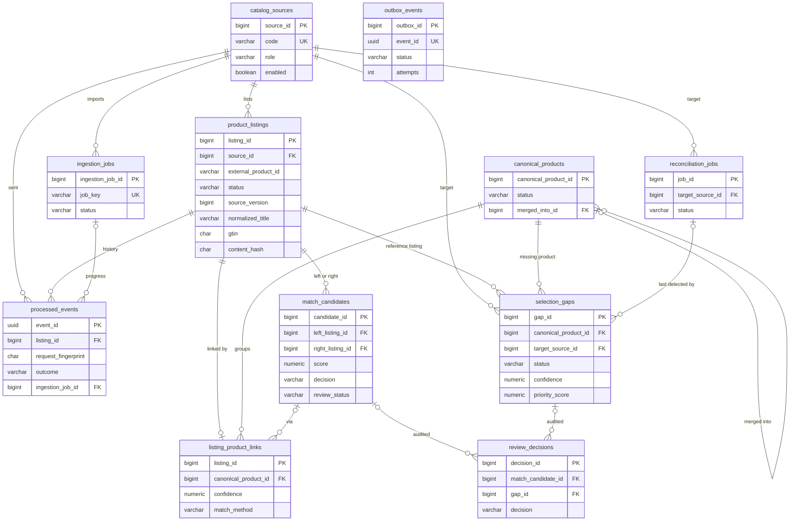

# Database

PostgreSQL 16, accessed through Spring JDBC with explicit SQL (no ORM). The schema is created by six additive
Flyway migrations in [`db/migrations`](../db/migrations):

| Migration | Adds |
|---|---|
| `V1__catalog_core.sql` | `catalog_sources`, `product_listings`, `processed_events` (idempotency ledger), `outbox_events`, the `pg_trgm` extension, the `touch_updated_at` trigger |
| `V2__product_intelligence.sql` | `canonical_products`, `listing_product_links`, `match_candidates`, candidate-retrieval indexes |
| `V3__selection_gaps.sql` | `reconciliation_jobs`, `selection_gaps`, append-only `review_decisions` |
| `V4__ingestion_jobs.sql` | `ingestion_jobs`, the ledger's foreign key to it and the job-progress index |
| `V5__match_evidence_currency.sql` | The `SUPERSEDE` decision in `review_decisions`, recorded when a listing change invalidates a human match decision ([ADR 0013](adr/0013-match-evidence-currency.md)) |
| `V6__durable_reconciliation_jobs.sql` | Attempts, retry time and lease columns on `reconciliation_jobs`, their checks and the two poller indexes |

Every migration file carries comments explaining its constraints and indexes; this document is the overview.

## Entity-relationship diagram

The full diagram with more columns and both relationship ends of `match_candidates` and `selection_gaps` is
[diagrams/er-diagram.mmd](diagrams/er-diagram.mmd) (rendered: [er-diagram.svg](diagrams/er-diagram.svg)).

## Tables, constraints and why they exist

### `catalog_sources`

Marketplaces (`MARKETPLACE`, the selection being monitored) and reference catalogs (`REFERENCE`, the benchmark).
`code` is unique and restricted to `^[a-z0-9][a-z0-9_-]{1,63}$` because it appears in events, URLs and queue
attributes. Disabling a source makes new events for it unprocessable (`SOURCE_DISABLED`) without deleting
history.

### `product_listings`

One row per `(source_id, external_product_id)`, enforced by a unique constraint: that constraint is what makes
two concurrent "create" events for the same listing produce one row (`INSERT … ON CONFLICT DO NOTHING`, then the
loser re-locks the winner's row and decides against it).

| Constraint | Purpose |
|---|---|
| `ck_product_listings_active_has_content` | An `ACTIVE` listing must have a title and content hash; a tombstone may not (a withdrawal can arrive before any upsert) |
| `ck_product_listings_withdrawn_at` | `withdrawn_at` is set exactly when the status is `WITHDRAWN` |
| `ck_product_listings_version` | Source versions are non-negative; ordering is by `source_version`, never by arrival time |
| `ck_product_listings_gtin`, `_hash`, `_attributes` | GTIN is stored as canonical GTIN-14, the hash as 64 hex digits, attributes as a JSON object |

Raw fields are kept next to normalized ones (`normalized_title`, `normalized_brand`, `normalized_model`,
`normalized_category`, `category_leaf`, `extracted_attributes`, `normalization_version`) so matching can be
re-run under a new normalizer and so reviewers see both.

| Index | Serves |
|---|---|
| `ix_product_listings_source_id (source_id, listing_id DESC)` | Catalog explorer per source, keyset-paginated newest first |
| `ix_product_listings_status_id (status, listing_id DESC)` | Status filters and dashboard counts |
| `ix_product_listings_gtin_active` (partial: GTIN present, `ACTIVE`) | Exact-identifier candidate retrieval |
| `ix_product_listings_brand_model_active (normalized_brand, normalized_model text_pattern_ops)` (partial: `ACTIVE`) | Brand + model equality and model-prefix retrieval |
| `ix_product_listings_title_trgm_active` (GIN `gin_trgm_ops`, partial: `ACTIVE`) | Title similarity (`%`, `similarity()`), also `ILIKE '%term%'` search |

The three retrieval indexes are partial on `status = 'ACTIVE'` because withdrawn listings are never candidates.

### `processed_events` — the idempotency ledger

The primary key on `event_id` makes "apply each event at most once" a database guarantee rather than an
application convention. `request_fingerprint` (SHA-256 of everything in the event except its id) distinguishes an
exact replay (return the stored outcome) from a reused id carrying different data (`EVENT_ID_REUSED`).
`ck_processed_events_applied` ties `applied_version` to the outcome: it is `NULL` exactly for `STALE_IGNORED` and
`VERSION_CONFLICT`, the outcomes that change nothing.

| Index | Serves |
|---|---|
| `ix_processed_events_listing (listing_id, processed_at DESC)` | Listing history in `GET /listings/{id}` |
| `ix_processed_events_processed_at_brin` (BRIN) | Time-window metrics. The table is append-only and `processed_at` grows with insertion order, the ideal case for BRIN: a few pages instead of a B-tree as large as the table |
| `ix_processed_events_job_outcome (ingestion_job_id, outcome)` (partial) | Batch job progress, derived from the ledger instead of a counter on the job row |

### `outbox_events`

Change events written in the same transaction as the state change they describe and published to SQS by the
relay afterwards (no lost and no phantom events). `event_id` is unique so a retried transaction cannot enqueue a
duplicate. `ck_outbox_events_published` keeps `published_at` consistent with the status.

| Index | Serves |
|---|---|
| `ix_outbox_events_due (next_attempt_at, outbox_id)` partial on `PENDING` | The relay's poll. Only unpublished rows are in it, so it stays small however much history accumulates |
| `ix_outbox_events_published_at` partial on `PUBLISHED` | Retention purge (published rows older than 7 days, in batches, every 10 minutes) |
| `ix_outbox_events_failed` partial on `FAILED` | Operator view and alerting on rows that exhausted their attempts |

### `canonical_products` and `listing_product_links`

Platform-owned product identities, independent of any supplier's listing. A listing links to at most one
canonical product (`listing_id` is the primary key of the link table) with a confidence, method
(`NEW_IDENTITY`, `GTIN_EXACT`, `RULES_AUTO`, `REVIEW_APPROVED`, `MERGED`), review status and the content hash it
was linked under, so a changed listing is re-matched. Merging keeps the absorbed identity as `MERGED` with
`merged_into_id` (checked not to point at itself) instead of deleting it, so references stay valid.

### `match_candidates`

Each scored pair is stored once in canonical order (`ck_match_candidates_order: left < right` plus the unique
pair constraint), with `score`, `decision`, per-feature scores, evidence, `matcher_version`, the retrieval method
that found it and both content hashes. `ck_match_candidates_reviewed` requires reviewer and time exactly for
human decisions. `ix_match_candidates_review_queue (score DESC, candidate_id DESC)` partial on `PENDING` is the
reviewer queue: only the actionable backlog is indexed.

A candidate is **current** while both listings are `ACTIVE` and their content hashes still equal
`left_content_hash` and `right_content_hash`. Only current, accepted candidates (`AUTO_MATCH` auto-accepted or
human-approved) link listings, merge identities, feed gap evidence or can be reviewed; when a listing changes, its
non-current candidates of every status become `SUPERSEDED`, and a superseded human decision gets a `SUPERSEDE`
row in `review_decisions` by `system:matching` ([ADR 0013](adr/0013-match-evidence-currency.md)).

### `reconciliation_jobs`

`uq_reconciliation_jobs_active_target`, a partial unique index on `target_source_id` for `PENDING` and `RUNNING`
rows, allows at most one active run per marketplace: two runs would race on the same gaps, and the database
enforces this rather than an application lock. `idempotency_key` is unique, so a retried `POST` returns the
existing job.

Jobs are durable work items (V6). A poller claims one `PENDING` job whose `next_attempt_at` is due, or a `RUNNING`
job whose lease has expired with attempts left, using `FOR UPDATE SKIP LOCKED`, and sets `lease_owner` and
`lease_expires_at` (database time) and increments `attempt`. Renewals, completion and failure are conditional on
`lease_owner`, so a runner that lost its lease cannot overwrite the job.

| Constraint or index | Purpose |
|---|---|
| `ck_reconciliation_jobs_attempts` | `0 ≤ attempt ≤ max_attempts`, `max_attempts ≥ 1`: retries are bounded by the schema |
| `ck_reconciliation_jobs_lease` | A job has a lease owner and expiry exactly while it is `RUNNING` |
| `ix_reconciliation_jobs_due (next_attempt_at, job_id)` partial on `PENDING` | The poller's scan for due jobs |
| `ix_reconciliation_jobs_leases (lease_expires_at, job_id)` partial on `RUNNING` | The scan for expired leases (crashed runners) |

### `selection_gaps`

`uq_selection_gaps_active`, a partial unique index on `(canonical_product_id, target_source_id)` for `OPEN`,
`CONFIRMED` and `DISMISSED`, is the deduplication rule: a product has at most one live gap per marketplace.
`DISMISSED` is included so a dismissal suppresses re-detection; `RESOLVED` rows are history, so a product that
disappears again after being resolved opens a new gap. Resolutions written by reconciliation are
`AUTO_MATCH_FOUND`, `MERGED_PRODUCT`, `REFERENCE_WITHDRAWN` and `REFERENCE_SOURCE_DISABLED` (only disabled
reference sources still list the product). When a product is merged into another, its live gap moves to the
survivor (`canonical_product_id` is updated, the gap keeps its id and history); `MERGED_PRODUCT` is used only when
the survivor already has its own live gap ([ADR 0014](adr/0014-gaps-follow-product-merges.md)). `ck_selection_gaps_resolved` keeps resolution fields
consistent with the status. The triage indexes `(target_source_id, status, priority_score DESC, gap_id DESC)` and
`(status, priority_score DESC, gap_id DESC)` match the gap list's filters and keyset order.

### `review_decisions`

The audit trail for match and gap reviews. `ck_review_decisions_subject` requires exactly one subject per row. A
row trigger rejects `UPDATE` and `DELETE` and a statement trigger rejects `TRUNCATE`, so even SQL that bypasses
the application cannot rewrite history (tested in `GapReconciliationIT.auditTrailIsAppendOnlyAtTheDatabaseLevel`).
`idempotency_key` is unique: a retried decision with the same `Idempotency-Key` header returns the original
decision instead of recording a second one.

### `ingestion_jobs`

Batch imports. `job_key` is derived from the manifest and unique, so re-submitting the same manifest resumes the
same job. Counts are checked non-negative, `error_summary` must be a JSON array, `attempt` starts at 1 and is
incremented when a `FAILED` job is restarted.

## Transactions and concurrency

- **Isolation**: READ COMMITTED everywhere, with explicit row locks where a decision depends on current state.
  SERIALIZABLE would also be correct but turns contention into retryable serialization failures on hot listings;
  the explicit locks make the serialization point visible in the code.
- **Patterns used**: `SELECT … FOR UPDATE` (listing decisions, gap and candidate reviews, job transitions);
  `INSERT … ON CONFLICT DO NOTHING` plus a re-read (listing creation, job registration, ledger inserts);
  `FOR UPDATE SKIP LOCKED` (outbox relay claims, so relay instances never publish one row in overlapping runs);
  partial unique indexes as invariants (one active reconciliation per target, one live gap per product and target).
- **Timeouts**: application transactions have a 10 s timeout; HikariCP connection acquisition times out after 5 s.
- **Retries**: a lost race on the ledger primary key, or a lock failure, is retried up to 4 times inside the
  ingestion service; anything else propagates to the queue consumer, which retries with backoff.

## Pagination

Collection endpoints use keyset pagination: the opaque, versioned cursor encodes the sort key of the last row
returned and the next page continues strictly after it. Each page costs O(page size) and stays stable under
concurrent inserts, unlike `OFFSET` ([ADR 0007](adr/0007-keyset-pagination.md)). Every list query has an index
whose order matches its sort.

## Migrations policy

- Migrations are additive and never edited after they are applied; a change is a new `V<n>__*.sql`.
- The API runs Flyway at start-up (`FLYWAY_ENABLED`, default true); the worker does not run migrations. Flyway
  takes a database lock, so several API tasks starting together apply each migration once.
- `pg_trgm` is a trusted extension (PostgreSQL 13+), so the database owner can create it without superuser; it
  is on the Amazon RDS supported-extension list.

## Measured query performance

From [benchmarking.md](benchmarking.md), 20,000 listings on the development machine:

- Title-trigram retrieval: 17–28 ms with the GIN index against 208–220 ms with a sequential scan for the same
  query. It is the matching bottleneck: 84 % of all statement time in a profiled run (mean 32.4 ms per call),
  while the GTIN and brand + model lookups average 0.02–0.04 ms.
- With literal values (custom plans) and the default `random_page_cost = 4`, the planner chose a sequential scan
  for 62 of 300 sampled titles; at 1.1 it kept the index for all of them. The application's prepared statement
  switches to a generic plan that always uses the index, so end-to-end matching time did not change. The compose
  stack and the RDS parameter group set 1.1 as the appropriate cost model for cached or SSD-backed data.
